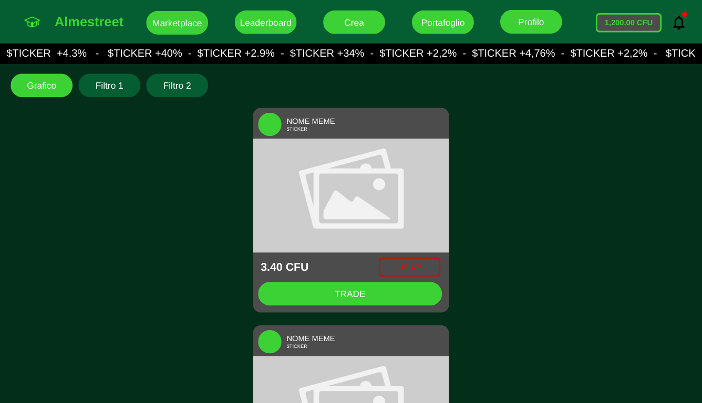
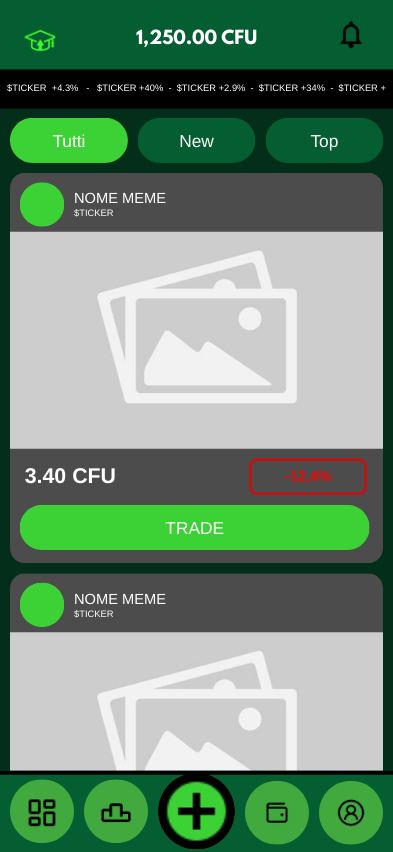
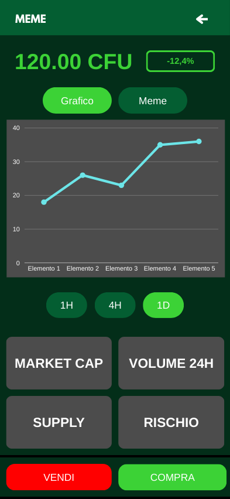
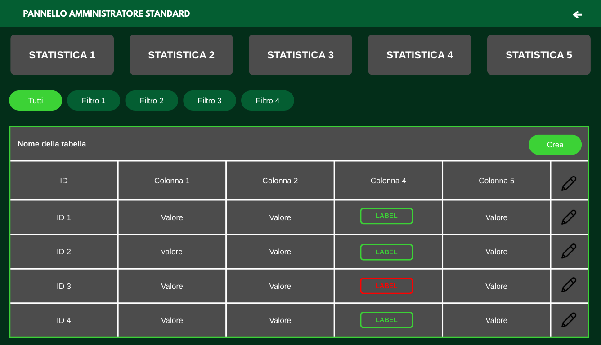

# AlmaStreet UI Mockups

This report documents the main AlmaStreet screens and components from a UX/UI perspective. It complements the system-level UML diagrams described in docs/uml/report.md.

---

## Marketplace (Student View)
- **Desktop mockup**:

  

- **Mobile mockup**:

  

- **Description**:
  - Top navigation with AlmaStreet logo and primary sections: Marketplace, Leaderboard, Create, Portfolio, Profile.
  - A horizontal ticker showing trending tickers and percentage changes.
  - Filter buttons (e.g. All, New, Top) for segmenting memes.
  - Meme cards displaying:
    - Meme title and ticker.
    - Placeholder for meme image.
    - Current price in CFU and a performance label (green or red) for percentage change.
    - A prominent “Trade” call‑to‑action button.
  - Mobile mockup shows the same card structure in a single‑column, thumb‑friendly layout with a bottom navigation bar.

## Meme Detail & Trading Screen
- **Mobile mockup**:

  

- **Description**:
  - Header with meme name and a back navigation icon.
  - The current price in CFU with a colored performance badge (e.g. −12.4%).
  - Toggle between “Chart” and “Meme” views.
  - Price chart area (e.g. line chart) with timeframe selectors (1H, 4H, 1D).
  - KPI tiles such as Market Cap, 24H Volume, Supply, and Risk.
  - Fixed bottom bar with distinct “Sell” (red) and “Buy” (green) buttons.
  - This screen directly supports the Trading Flow UML by showing where slippage‑controlled trades are initiated.

## Admin Dashboard – Statistics & Tables
- **Desktop mockup**:

  

- **Description**:
  - Top bar with “Admin Panel” title and back navigation.
  - Large statistic tiles (STATISTIC 1–5) for key KPIs.
  - Filter buttons (All, Filter 1–4) to switch table views.
  - Data table area with:
    - Sticky ID column.
    - Configurable columns (e.g. financial or moderation metrics).
    - Status labels in green or red to indicate critical states.
    - Edit icons for row‑level actions.
  - Mobile mockup keeps the same structure in a vertical layout, emphasizing readability and scrollable content.